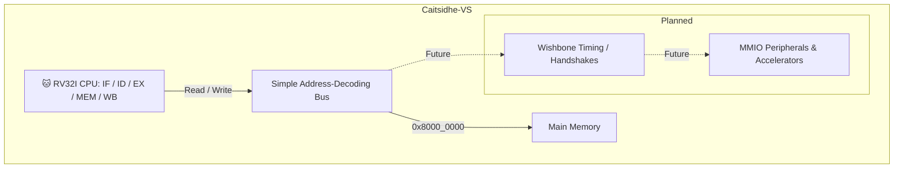

# 🐱 Caitsidhe-VS


**Caitsidhe-VS** (pronounced *Cat-Sith*) is a RISC-V System-on-Chip simulator written in C++ based on Caitsidhe-V RTL designs.
Caitsidhe-VS is designed to model hardware behavior, including a bus interconnect (Wishbone) and MMIO. It serves as a sandbox playground for experimenting with CPU microarchitectures, hardware accelerators and peripherals.

**Current status:** An initial five-stage RV32I pipeline simulator is executable, with a simple synchronous RAM-backed bus, forwarding, load-use stalls and control-flow flushes. It is not yet cycle-validated against Caitsidhe-V RTL and the interconnect is not yet a Wishbone protocol implementation. The goal is to get there, not to pretend we're already there.

---

## Architecture



The CPU uses two phases: `eval()` computes next pipeline states using the current state, `commit()` advances the registers and applies register-file/memory writes. The memory model currently has zero wait states and no arbitration. Branches are resolved in EX, with IF/ID flushed on a taken branch or jump. Forwarding is implemented from EX/MEM (except loads) and MEM/WB, a load-use dependency injects one bubble.

## Features

- **Simulation**: Five-stage, single-issue, in-order pipeline with deterministic evaluate/commit transitions (experimental).
- **RV32I execution**: ALU register/immediate operations, LUI, AUIPC, jumps, branches, byte/halfword/word loads and stores.
- **Hazards**: EX/MEM and MEM/WB forwarding, load-use interlock, taken-branch flushing.
- **Memory**: Byte-addressable, little-endian RAM, checked bounds and alignment, byte strobe writes.
- **Statistics**: Cycles, retired instructions, CPI, load-use stall cycles and control redirects.
- **Tests**: CTest smoke tests for arithmetic, immediates, memory, hazards, branches and jumps.

**Not yet implemented:** Timed Wishbone protocol (ACK/STALL/ERR), MMIO devices, trace files, CSR/privileged architecture, interrupts, exceptions/traps, `FENCE`/`FENCE.I` behavior, `ECALL`, ISA compliance suites and RTL cycle-by-cycle equivalence. Unsupported instructions cause a simulator error. `EBREAK` (`0x00100073`) is temporarily used as a simulation-stop sentinel instead of a proper breakpoint exception.

---

## Memory Map

- `0x8000_0000` - `0x800F_FFFF`: RAM, 1 MiB by default (`MEM_SIZE` in `src/common/types.h`).
- `0x9000_0000` - `0x9FFF_FFFF`: Planned MMIO region (not mapped yet).

The executable loads a raw little-endian `.bin` into RAM at `0x8000_0000`. It does not load ELF files. A program must use the correct link/load address and end with `EBREAK` to terminate normally. There is currently no linker script, startup runtime, UART output or operating-system environment.

## Project Structure

```text
src/
├── common/         # Base types, ISA fields and bit manipulation utilities
├── core/           # ALU, pipeline registers, CPU and register file
├── memory/         # Byte-addressable RAM and basic bus
├── peripherals/    # Placeholder for future UART and MMIO peripherals
└── main.cpp        # Raw binary loader, simulation loop and statistics
tests/
└── test_cpu.cpp    # Self-contained ISA and pipeline smoke tests
```

## Getting Started

Prerequisites: a C++20 compiler and CMake 3.16+.

```bash
cmake -S . -B build
cmake --build build
ctest --test-dir build --output-on-failure
```

Run a raw binary (little-endian RV32I, linked at `0x80000000`):

```bash
./build/Caitsidhe_V path/to/program.bin 100000
```

The second argument is an optional maximum number of cycles (default: 1,000,000). Exit code 0 means an `EBREAK` was retired, exit code 2 means the cycle limit was reached, exit code 1 indicates a loading or simulation error. Results include a register dump and summary statistics.

To run the built-in verification without a RISC-V toolchain:

```bash
./build/caitsidhe_tests
```

The smoke tests do **not** establish full RV32I compliance or RTL cycle accuracy.

---

## My development roadmap

- [x] Basic Memory (RAM) & Bus Infrastructure (simple bus, not Wishbone yet)
- [x] Register File & ALU Implementation (initial RV32I operations)
- [x] CPU Core: Fetch & Decode Stages (initial pipeline)
- [x] CPU Core: Execute & Writeback Logic (initial pipeline)
- [x] Pipeline: Hazard Detection & Forwarding Unit (load-use and basic forwarding)
- [x] Verification: Self-contained CTest smoke tests
- [ ] Bus: Wishbone cycle-level protocol with ACK/STALL/ERR and wait states
- [ ] MMIO: A bunch of peripherals (UART, timer, GPIO, accelerators...)
- [ ] ISA: Exception handling, ECALL/EBREAK traps, FENCE, CSRs and privileged support
- [ ] Verification: Trace comparison with Caitsidhe-V RTL in FPGA, Spike & riscv-arch-test
- [ ] Performance: Full per-stage traces and deeper pipeline statistics
- [ ] Docs: Architecture design notes, examples, linker scripts and tutorials
- [ ] Tester and debug tools: Bus Mocker for Peripheral testing (Matatabi Mocker)

### Important design note

The current CPU implementation is a baseline model, not a claim that the timing matches existing Caitsidhe-V RTL revisions.

---

## License

This project is licensed under the Apache License 2.0. See the [LICENSE](LICENSE).

---

### Some notes about the project

- Q: Why "Caitsidhe-VS"?
  - Caitsidhe (Cat-Sith) is a fairy creature from Scottish and Irish mythology, how I got that far? I don't know, I just liked the name and the cat reference.
  - The "V" stands for RISC-V, the ISA being implemented, and "S" for Simulation... becuse it simulates... a RISC-V? Yeah. SoC = System of Cats... I mean, System-on-Chip.
- Q: Why I am doing this?
  - Honestly? I almost failed in my Computer Architecture class. So... This is my revenge!
  - Also... I have a big interest in Verilog, FPGAs and Embedded Systems. I... just can't get enough of hardware stuff.
- Q: What is the purpose of this project?
  - Caitsidhe-V is, primarily, a tool for developing peripherals and hardware accelerators in a more "hardware-like" environment.
  - It can also be used as a learning tool for understanding RISC-V architecture and SoC design.
  - And... QEMU is fantastic, but trying to add a simple custom peripheral to it is... well... 'QEMU Levels of harshness'. Caitsidhe-V is designed to be hackable and be hacked.
- Q: Is this project production-ready?
  - **No.** This project is a work in progress (WIP). Use at your own risk.
- Q: Why make it "Peripheral-Centric"?
  - Most computers don't task the CPU with everything. Peripherals and hardware accelerators offload specific tasks from the CPU, improving overall system performance and efficiency.
  - This project aims to provide a platform for experimenting with such peripherals without the complexity of HDLs like Verilog.
  - Plus, peripherals are fun to make!
- Q: Can I contribute?
  - Absolutely! Feel free to open issues or submit pull requests.
  - **Rule #1:** (Optional but encouraged) YOU MUST CONTRIBUTE WITH CAT MEMES!
- Q: Which themes you use in VSCode?
  - **Catppuccin-Mocha** and **Fira Code Nerd Font**. (Because cats and fonts matter).

---

<div style='text-align: center,'>
  Build with ❤️ and 😸 by André L. Jordão!
</div>
