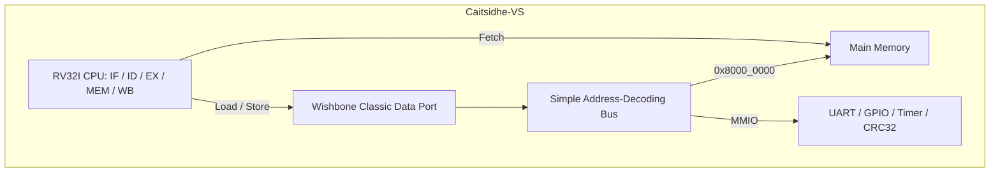

# 🐱 Caitsidhe-VS


[](https://github.com/AndreLimaJordao/Caitsidhe-VS/actions/workflows/tests.yml)

**Caitsidhe-VS** (pronounced *Cat-Sith*) is a RISC-V System-on-Chip simulator written in C++ based on Caitsidhe-V RTL designs.
Caitsidhe-VS is designed to model hardware behavior, including a bus interconnect (Wishbone) and MMIO. It serves as a sandbox playground for experimenting with CPU microarchitectures, hardware accelerators and peripherals.

Current status: The five-stage RV32I pipeline runs raw binaries and bare-metal ELFs. The data port models Wishbone Classic with configurable wait states. The command-line board has UART (TX), GPIO, Timer and a CRC32 accelerator. There's also a machine-mode demo, a tool for poking peripherals and a differential test against Unicorn.

## Architecture



The CPU uses two phases, `eval()` computes next pipeline states using the current state, `commit()` advances the registers and applies register-file/memory writes. Instruction fetch uses RAM directly. Loads and stores use the data port, which defaults to zero wait states. Branches are resolved in EX, with IF/ID flushed on a taken branch or jump. Forwarding is implemented from EX/MEM (except loads) and MEM/WB, and a load-use dependency injects one bubble.

A taken branch or jump also discards faults from the wrong path. After older instructions finish committing, a fault on the executed path either goes to the firmware trap handler in machine mode or stops the simulation.

## Features

- **Simulation**: Five-stage, single-issue, in-order pipeline with deterministic evaluate/commit transitions (experimental).
- **RV32I execution**: ALU register/immediate operations, LUI, AUIPC, jumps, branches, byte/halfword/word loads and stores.
- **Hazards**: EX/MEM and MEM/WB forwarding, load-use interlock, taken-branch flushing.
- **Memory**: Byte-addressable, little-endian RAM, checked bounds and alignment, byte strobe writes.
- **MMIO**: UART TX, GPIO, Timer, CRC32 and a reusable `RegisterBank` for custom devices.
- **Statistics and traces**: Cycles, retired instructions, CPI, stalls and control redirects. JSON Lines traces capture retirement, data accesses and traps.
- **Tests**: CTest regressions for CPU, MMIO, and independently assembled RV32I programs.

**Still on the roadmap:** Wishbone pipelined transfers and arbitration, more privileged architecture, `FENCE.I`, ACT4 and cycle-by-cycle comparison with Caitsidhe-V RTL.

## Memory Map

Both command-line runners use this board. Register offsets are relative to each base address.

| Base | Device | Registers |
|---|---|---|
| `0x8000_0000` | RAM (1 MiB) | Through `0x800F_FFFF` |
| `0x9000_0000` | UART TX | `DATA +0x00`, `STATUS +0x04` |
| `0x9000_1000` | GPIO | `DATA +0x00`, `DIRECTION +0x04`, `INPUT +0x08` |
| `0x9000_2000` | Timer | `COUNT +0x00`, `COMPARE +0x04`, `CONTROL +0x08` |
| `0x9000_3000` | CRC32 | `DATA +0x00`, `RESULT +0x04`, `CONTROL +0x08` |

Want to wire up your own stuff? Start with a plain `SoC` and attach devices with `SoC::attach(base, size, peripheral)`. Call `SoC::tick()` to advance both the CPU and the attached devices. See [ARCHITECTURE.md](ARCHITECTURE.md#minimal-peripheral-example) for a tiny example.

## Project Structure

```text
src/
├── common/         # Base types, ISA fields and bit manipulation utilities
├── core/           # ALU, pipeline registers, CPU and register file
├── memory/         # Byte-addressable RAM and basic bus
├── peripherals/    # UART, GPIO, Timer, CRC32 and the peripheral API
├── platform/       # SoC composition and the command-line board
├── program/        # ELF32 loader
├── main.cpp        # Raw binary runner and statistics
├── elf_main.cpp    # ELF runner, tohost and signature checks
└── matatabi_main.cpp # Exercise a peripheral with a script
examples/
├── uart_timer.S    # A bare-metal cat with a Timer and a UART
├── timer_irq.S     # The same cat learns to handle interrupts
└── crc32.S         # Check a CRC result through MMIO
tests/
├── test_cpu.cpp         # Self-contained ISA and pipeline smoke tests
├── test_peripherals.cpp # CPU-driven MMIO and address map tests
├── test_devices.cpp     # UART, GPIO and Timer behavior
├── rv32i_program.S      # Independently assembled ISA regression
└── isa/                 # ELF regressions and bare-metal linker script
```

## Getting Started

You'll need a C++20 compiler. Use CMake 3.21+ for the commands and test reports below.

```bash
cmake -S . -B build -DCMAKE_BUILD_TYPE=Debug
cmake --build build --config Debug
ctest --test-dir build -C Debug --output-on-failure
```

Use `Caitsidhe_V` for a raw little-endian RV32I binary linked at `0x80000000`.

```bash
./build/Caitsidhe_V path/to/program.bin 100000
```

The second argument is an optional cycle limit (default 1,000,000). Exit code 0 means an `EBREAK` was retired, exit code 2 means the cycle limit was reached, and exit code 1 indicates a loading or simulation error. Results include a register dump and summary statistics.

Use `caitsidhe_elf` for a little-endian RV32 ELF32 executable with its entry point at `0x80000000`. There is a [bare-metal linker script](tests/isa/link.ld) in the repo.

```bash
./build/caitsidhe_elf path/to/program.elf 100000
```

The ELF runner stops on `tohost` when it finds that symbol. A value of 1 means pass, and any other nonzero value means fail. By default, programs without that symbol stop on `EBREAK`. Use `--signature-output file` to dump the region from `begin_signature` to `end_signature`, or `--reference file` to compare it against a signature file.

Both runners accept `--trace path.jsonl`, `--wait-states N` and `--machine`. In machine mode `EBREAK` goes to the trap handler. Use the ELF runner and a `tohost` symbol to end a machine-mode demo.

With Visual Studio's CMake generator, run the `.exe` files from `build/Debug/`.

## A tiny bare-metal cat

The [UART + Timer demo](examples/uart_timer.S) starts the Timer, waits for it to count to 12, then prints `Meow!` over UART and stops with `EBREAK`. With a Clang build that targets RISC-V and LLD available, the default test build assembles the ELF. Add `llvm-objcopy` to get the raw binary too.

```bash
./build/caitsidhe_elf build/uart_timer.elf 200
./build/Caitsidhe_V build/uart_timer.bin 200
```

The [interrupt demo](examples/timer_irq.S) checks three synchronous traps, then lets the Timer interrupt the program. The handler prints `Meow!` and returns with `MRET`.

```bash
./build/caitsidhe_elf build/timer_irq.elf 2000 --machine --wait-states 5 --trace timer_irq.jsonl
```

## Matatabi Mocker

Want to poke a peripheral without writing firmware first? Give Matatabi a script with `write OFFSET VALUE LANES`, `read OFFSET`, `expect OFFSET VALUE` and `tick COUNT`. Offsets are relative to the device, and numbers can be decimal or hex.

```bash
./build/matatabi_mocker crc32 tests/matatabi_crc32.txt
./build/matatabi_mocker timer tests/matatabi_timer.txt
./build/caitsidhe_elf build/crc32.elf 200
```

## Verification

The C++ tests run without a RISC-V toolchain, and their checks stay active in Release. Clang and LLD add the ELF regressions. With `llvm-objcopy`, CTest also runs the raw RV32I regression and the raw version of the cat demo.

```bash
python3 tools/run_tests.py
```

The script builds the project, runs CTest and writes a case-by-case report to `reports/summary.md`, `reports/results.json` and `reports/ctest.xml`. GitHub Actions publishes the same reports as CI artifacts.

### Compare against an independent emulator

The comparator runs the same ELF on Caitsidhe-VS and [Unicorn](https://github.com/unicorn-engine/unicorn), then checks the PC, instruction, all writable integer registers and data reads/writes at each step. It reports the first difference. The checked-in test covers RV32I programs that use RAM and end on `EBREAK`.

```bash
python -m pip install -r tools/reference-requirements.txt
python tools/run_tests.py --require-reference
```

To try a different RAM-only ELF, give the comparator the runner or an existing trace.

```bash
python tools/validate_reference.py --sim build/caitsidhe_elf --elf build/differential.elf
python tools/validate_reference.py --trace run.jsonl --elf my_program.elf
```

The differential tests check architectural effects. The local Wishbone and firmware tests cover device timing and interrupts. ACT4 and RTL cycle checks are separate milestones.

## My development roadmap

- [x] Basic Memory (RAM) & Address Decoding
- [x] Register File & ALU Implementation (initial RV32I operations)
- [x] CPU Core: Fetch & Decode Stages (initial pipeline)
- [x] CPU Core: Execute & Writeback Logic (initial pipeline)
- [x] Pipeline: Hazard Detection & Forwarding Unit (load-use and basic forwarding)
- [x] Verification: Self-contained CTest smoke tests
- [x] Bus: Wishbone Classic data port with ACK, ERR and wait states
- [ ] Bus: Wishbone pipelined transfers and arbitration
- [x] MMIO: UART (TX), timer and GPIO, with a bare-metal UART + Timer demo
- [x] MMIO: CRC32 accelerator and a firmware example
- [x] ISA: Machine-mode traps, selected CSRs, FENCE and Timer interrupts
- [x] Verification: Architectural traces and differential tests against Unicorn
- [ ] Verification: Cycle comparison with Caitsidhe-V RTL and riscv-arch-test integration
- [ ] Performance: Full per-stage traces and deeper pipeline statistics
- [ ] Docs: Architecture design notes, examples, linker scripts and tutorials
- [x] Tester and debug tools: Bus Mocker for Peripheral testing (Matatabi Mocker)

### Important design note

The current CPU implementation is a baseline model, not a claim that the timing matches existing Caitsidhe-V RTL revisions.

## Custom peripherals and architecture

Use `SoC`, `Peripheral` and `RegisterBank` to add user devices without changing
CPU internals or implementing Wishbone. See [ARCHITECTURE.md](ARCHITECTURE.md)
for the minimal example, transaction semantics, RTL mapping and official ISA
test integration roadmap.

When Clang with RISC-V target and `llvm-objcopy` are available, building with
CMake also assembles a bare-metal RV32I binary and registers a third CTest
regression. This is a local test, not an official RISC-V conformance suite.

## License

This project is licensed under the Apache License 2.0. See the [LICENSE](LICENSE).

## Some notes about the project

- Q: Why "Caitsidhe-VS"?
  - Caitsidhe (Cat-Sith) is a fairy creature from Scottish and Irish mythology, how I got that far? I don't know, I just liked the name and the cat reference.
  - The "V" stands for RISC-V, the ISA being implemented, and "S" for Simulation... becuse it simulates... a RISC-V? Yeah. SoC = System of Cats... I mean, System-on-Chip.
- Q: Why I am doing this?
  - Honestly? I almost failed in my Computer Architecture class. So... This is my revenge!
  - Also... I have a big interest in Verilog, FPGAs and Embedded Systems. I... just can't get enough of hardware stuff.
- Q: What is the purpose of this project?
  - Caitsidhe-V is, primarily, a tool for developing peripherals and hardware accelerators in a more "hardware-like" environment.
  - It can also be used as a learning tool for understanding RISC-V architecture and SoC design.
  - And... QEMU is fantastic, but trying to add a simple custom peripheral to it is... well... 'QEMU Levels of harshness'. Caitsidhe-V is designed to be hackable and be hacked.
- Q: Is this project production-ready?
  - **No.** This project is a work in progress (WIP). Use at your own risk.
- Q: Why make it "Peripheral-Centric"?
  - Most computers don't task the CPU with everything. Peripherals and hardware accelerators offload specific tasks from the CPU, improving overall system performance and efficiency.
  - This project aims to provide a platform for experimenting with such peripherals without the complexity of HDLs like Verilog.
  - Plus, peripherals are fun to make!
- Q: Can I contribute?
  - Absolutely! Feel free to open issues or submit pull requests.
  - **Rule #1:** (Optional but encouraged) YOU MUST CONTRIBUTE WITH CAT MEMES!
- Q: Which themes you use in VSCode?
  - **Catppuccin-Mocha** and **Fira Code Nerd Font**. (Because cats and fonts matter).

<div style='text-align: center'>
  Build with ❤️ and 😸 by André L. Jordão!
</div>
